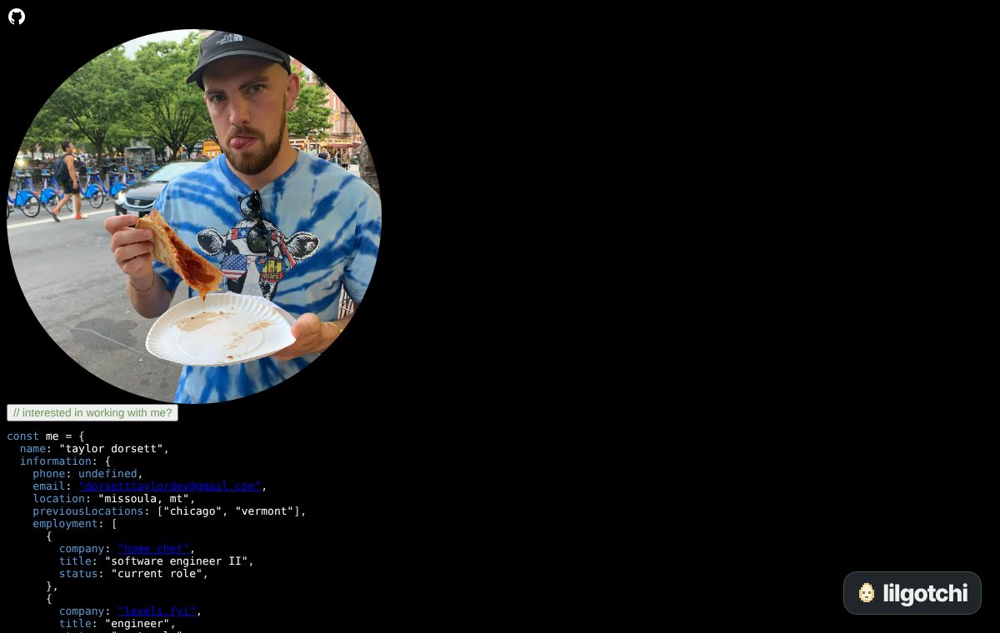

# taylordorsett.com

My personal site. It lives at [taylordorsett.com](https://www.taylordorsett.com/).

The home page is me, written as a JavaScript object. There is a pizza photo and a work photo, and a button to switch between them. The button in the corner opens [lilgotchi](https://github.com/TaylorOD/lilgotchi), a little pixel pet I built.



## What's here

| Path | What it is |
| --- | --- |
| `index.html` | Home page |
| `projects.html` | [Things I've built](https://www.taylordorsett.com/projects.html), also written as code |
| `pets/` | The pocket pet game that came before lilgotchi. See [pets/README.md](pets/README.md) |
| `assets/lilgotchi/` | Versioned builds of [lilgotchi](https://github.com/TaylorOD/lilgotchi) that the site uses. See [lilgotchi.md](lilgotchi.md) |
| `fightweek/` and `one-more-slice/` | Redirects from old project names to [fight terminal](https://www.taylordorsett.com/fight-terminal/) and [Snowcrust](https://www.taylordorsett.com/snowcrust/) |
| `404.html` | The page you get when a link is wrong |
| `pr-screenshots/` and `screenshots/` | Screenshots from PRs |

Most of my projects have their own repo. GitHub Pages serves each one on this domain, like [/relay/](https://www.taylordorsett.com/relay/), [/snowcrust/](https://www.taylordorsett.com/snowcrust/) and [/poker_seater/](https://www.taylordorsett.com/poker_seater/).

## What tech?

Plain HTML, CSS and JavaScript. Tailwind from a CDN on the home page. No framework and no build step.

## Running it locally

Serve the folder with anything that serves static files:

```sh
python3 -m http.server
```

Then open http://localhost:8000. The pets use JavaScript modules, so opening the file directly won't work.

Run the pet checks with:

```sh
node --test pets/game.test.mjs
```

## Publishing

Merging to master deploys the site to the `gh-pages` branch with GitHub Actions. Every PR gets its own preview link.
