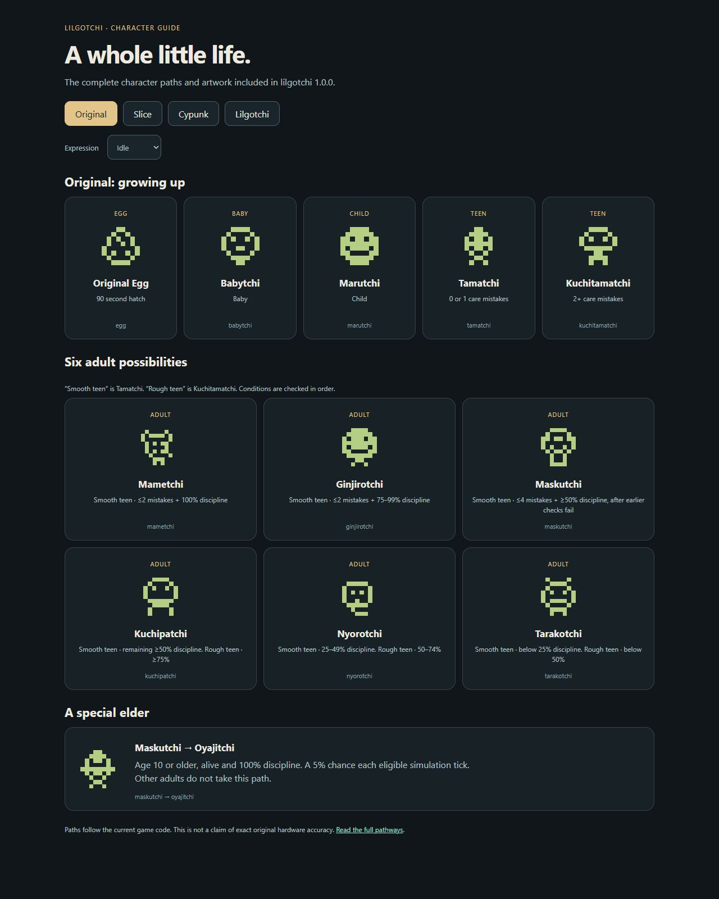
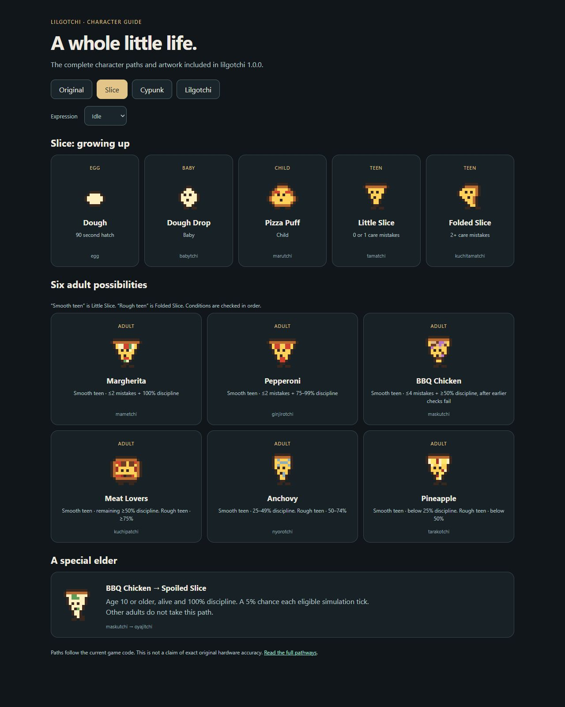
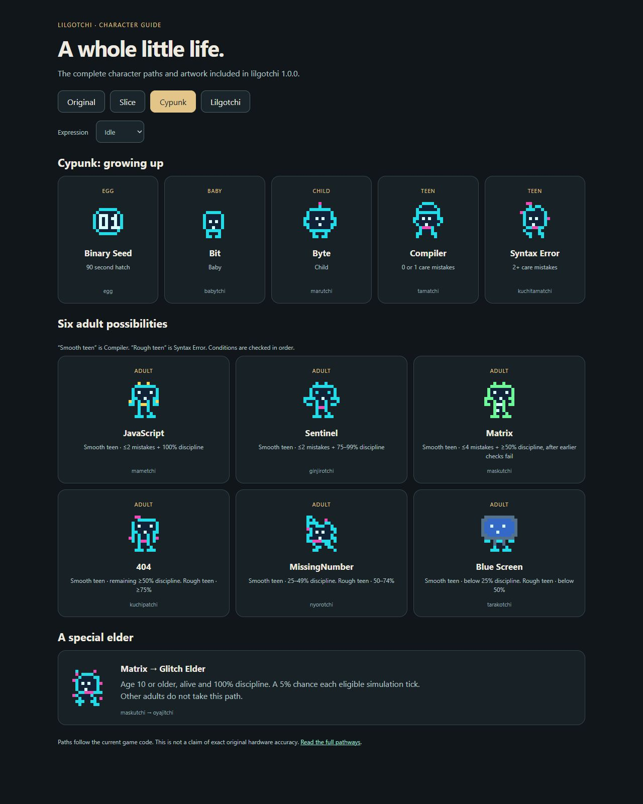
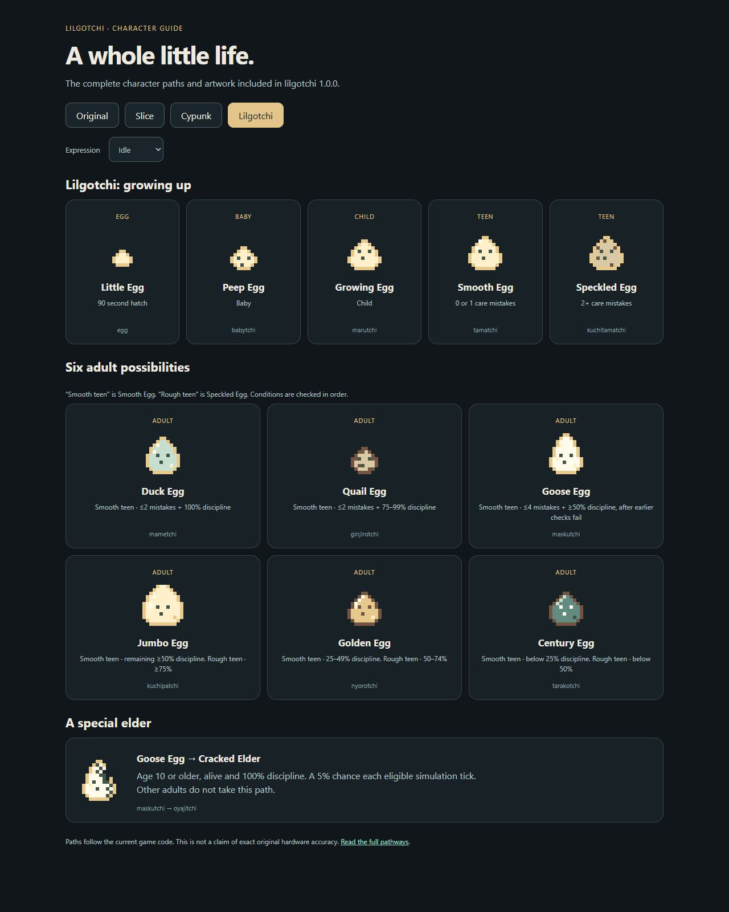

# Character choices

The full lineup is available by default. Each selection has its own save under your stable `storage-key`.

Cypunk keeps the `cyberpunk` configuration ID, asset paths and save keys for compatibility. Existing installs, exported backups and saved progress continue to work without migration. The name shown to players is Cypunk.

| ID | Starting stage |
| --- | --- |
| `default` | Original |
| `babytchi` | Baby |
| `marutchi` | Child |
| `tamatchi` | Teen |
| `kuchitamatchi` | Teen |
| `mametchi` | Adult |
| `ginjirotchi` | Adult |
| `maskutchi` | Adult |
| `kuchipatchi` | Adult |
| `nyorotchi` | Adult |
| `tarakotchi` | Adult |
| `oyajitchi` | Adult |
| `slice` | Slice egg |
| `cyberpunk` | Cypunk egg |

Named original choices are starting presets. They use the actual original sprites and begin at the pictured stage. Age and care history start at zero, with the minimum weight from the stage constants. Growth and care rules still apply. A teen can grow into another character. Choosing Mametchi does not lock every future life to Mametchi. Reset returns that save to its selected preset. The original egg still follows the normal full evolution path.

## Full family lineups

Each image shows every growth stage, the six adult branches and the special elder. Open an image to see it at full size.

### Original



### Slice



### Cypunk



### Lilgotchi



## Choose what your site offers

```html
<script type="module" src="/assets/lilgotchi/1.0.0/lilgotchi.js"></script>
<lil-gotchi characters="default,mametchi,slice" character="mametchi" storage-key="site-pet"></lil-gotchi>
```

Omit `characters` or use `characters="all"` for all 15 choices. Lists accept commas or spaces and preserve order. Unknown IDs and empty lists show an explicit configuration error. The setting is read when the element connects.

`await pet.setCharacter('mametchi')` selects an allowed choice and opens its existing save. It rejects unknown or unavailable IDs. Imports also reject unavailable choices before replacing anything. The picker contains only the site's allowed choices.

An allowed saved selection wins over `character` on a later visit. If it is no longer allowed, the first allowed choice is selected. Its excluded save is kept and becomes available again if the site restores that choice. With no saved selection, an allowed `character` wins, otherwise the first allowed choice is used.

## Save design

The public choice ID is the save identity, not the current evolved character. A Babytchi save remains in the `babytchi` slot after growing up. `default`, `slice` and `cyberpunk` retain their existing keys and import format. Named originals get distinct keys in the same versioned format. Legacy migration applies only to those original three slots, so an old classic save is never copied into every original character.

The shared catalog maps public IDs to the internal classic, pizza or cyberpunk skin. The frame validates that pair. All named originals use the classic skin and its normal evolution engine. This keeps appearance, picker choices, reset behavior and save identity consistent without separate game implementations.

## Lilgotchi

Use `lilgotchi` to start the logo egg family. It begins as a small egg and grows eyes, then a larger body. Its elder form has a crack. Each choice has its own saved progress.

## Special elder path

Pet types never change into another type. Care and discipline choose the adult branch within that type.

The special elder path is shared by the custom pet types. Reach the Maskutchi branch, then reach at least age 10 with 100% discipline:

| Pet type | Adult on this path | Elder appearance |
| --- | --- | --- |
| Slice | BBQ Chicken | Spoiled Slice, with mold spots and drooping cheese |
| Cypunk | Matrix | Glitch Elder, with broken cyan and magenta pixels |
| Lilgotchi | Goose Egg | Cracked Elder, with a missing shard and side crack |

To reach this branch from an egg, make at most one care mistake as a child to reach the Tamatchi teen. At adult evolution, at most four care mistakes and at least 50% discipline lead to Maskutchi unless the better care branches take priority. With at most two care mistakes, 75% or higher discipline selects a different adult. With three or four mistakes, the Maskutchi branch accepts any discipline from 50% through 100%.

After reaching that adult, raise discipline to 100% and keep the pet alive until age 10. Once eligible, each simulation tick has a 5% chance to trigger the change, so it does not happen at an exact birthday moment. The cracked egg, spoiled pizza and glitch look are special elder appearances, not automatic neglect outcomes. Other adults do not enter this path. Existing saves keep their progress and gain the new artwork when they use this elder form.

## Adult branches in 1.0.0

| Branch | Slice | Cypunk | Lilgotchi |
| --- | --- | --- | --- |
| Mametchi | Margherita | JavaScript | Duck Egg |
| Ginjirotchi | Pepperoni | Sentinel | Quail Egg |
| Maskutchi | BBQ Chicken | Matrix | Goose Egg |
| Kuchipatchi | Meat Lovers | 404 | Jumbo Egg |
| Nyorotchi | Anchovy | MissingNumber | Golden Egg |
| Tarakotchi | Pineapple | Blue Screen | Century Egg |

Existing saves retain their stage, care, age and identity. The artwork and display name for that identity update to this lineup. Sentinel is the original Cypunk adult artwork, now on the Ginjirotchi branch. Binary Seed retains its 0 and 1.
