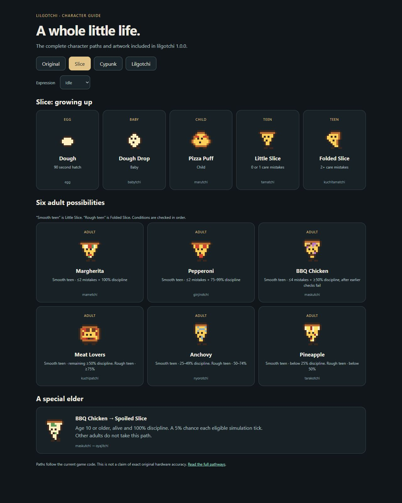
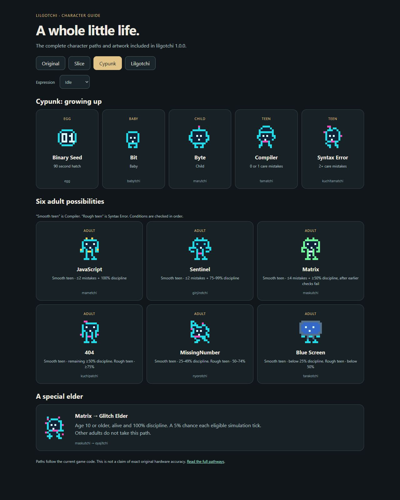
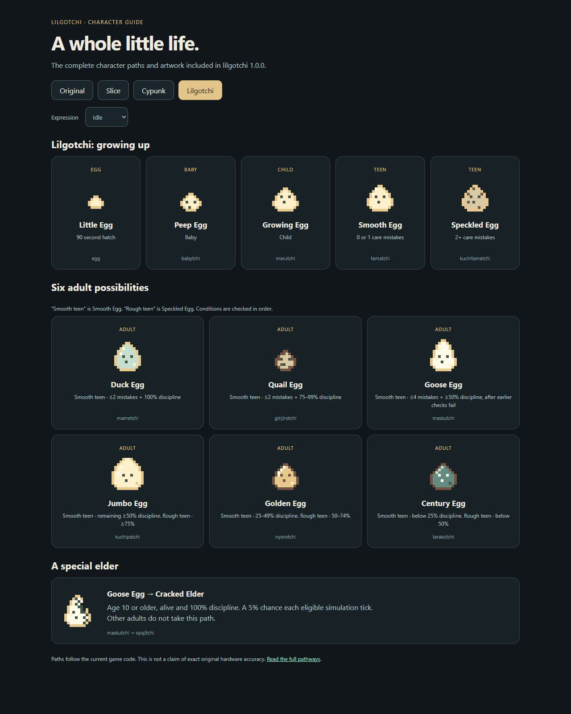
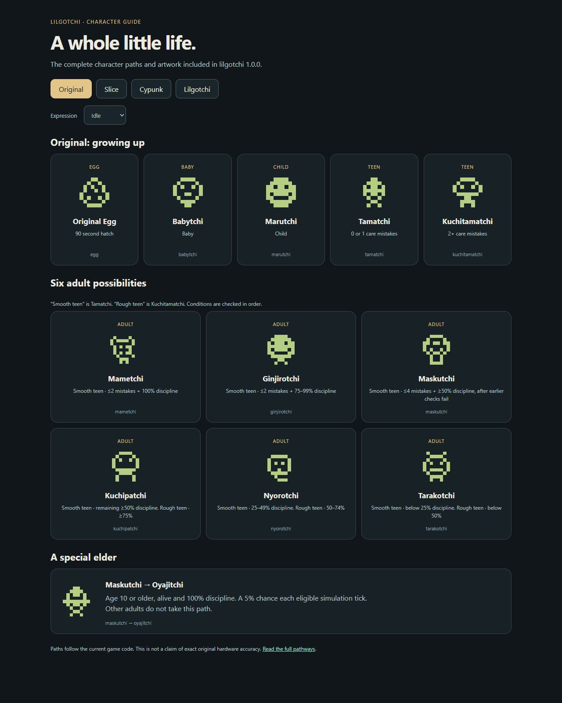

# Meet the pets

Pick a family and raise it from an egg. Slice stays pizza, Cypunk stays digital, Lilgotchi stays an egg and Original follows the classic character paths.

Each family has its own saved pet. Switching families doesn’t replace your progress.

| Family | Starts as | ID |
| --- | --- | --- |
| Slice | Dough | `slice` |
| Cypunk | Binary Seed | `cyberpunk` |
| Lilgotchi | Little Egg | `lilgotchi` |
| Original | Original Egg | `default` |

## The full lineups

Each image shows the stages, adult branches and special elder. Open it to see the full size.

### Slice

### Cypunk

### Lilgotchi

### Original

## How they grow

Eggs hatch in 90 seconds. Babies become children, then teens and adults. Care mistakes and discipline decide the path. All four families use the same rules.

The special elder path starts from BBQ Chicken, Matrix, Goose Egg or Maskutchi. At age 10 or older with full discipline, the pet has a 5% chance each eligible tick to become its elder. Other adults don’t take that path.

Spoiled Slice and Cracked Elder are special older forms. They don’t mean you neglected your pet.

[Install guide](install.md) · [Care guide](care.md)
