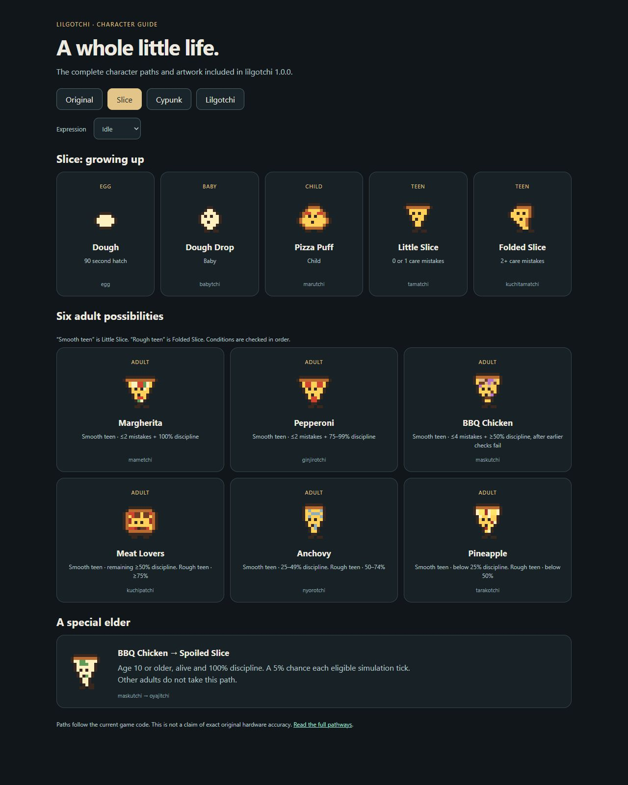
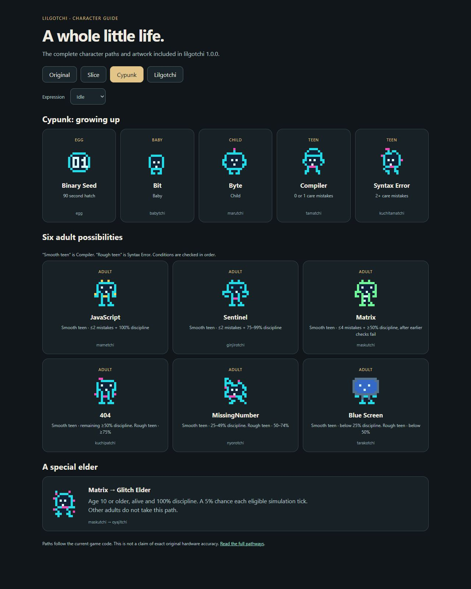
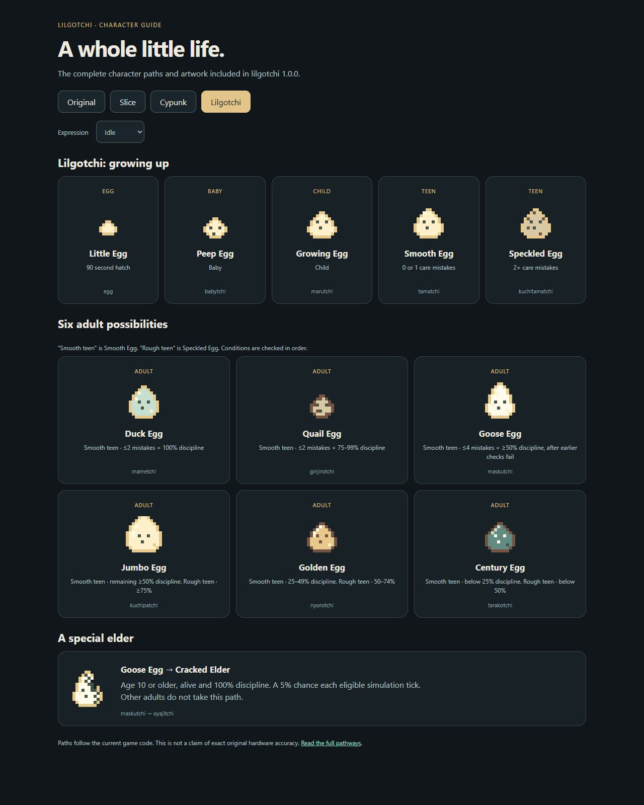

# Meet the pets

Pick a family and raise it from an egg. Slice stays pizza, Cypunk stays digital, Lilgotchi stays an egg. Gen 1 and Gen 2 follow separate character paths.

Each family has its own saved pet. Switching families doesn’t replace your progress.

| Family | Starts as | ID |
| --- | --- | --- |
| Slice | Dough | `slice` |
| Cypunk | Binary Seed | `cyberpunk` |
| Lilgotchi | Little Egg | `lilgotchi` |
| Gen 1 | Egg | `default` |
| Gen 2 | Egg | `original2` |

## The full lineups

Each image shows the stages, adult branches and special elder. Open it to see the full size.

### Slice

### Cypunk

### Lilgotchi

### Gen 1

Babytchi grows into Marutchi, then Tamatchi or Kuchitamatchi. Adults include Mametchi, Ginjirotchi, Maskutchi, Kuchipatchi, Nyorotchi and Tarakotchi. Maskutchi can become Oyajitchi or Bill.

### Gen 2

Shirobabytchi grows into Tonmarutchi, then Tongaritchi or Hashitamatchi. Adults include Mimitchi, Pochitchi, Nyatchi, Zuccitchi, Hashizoutchi, Kusatchi and Takotchi. Zuccitchi can become Sekitoritchi, Charitchi or Zatchi.

Both generations use source pixels from [DemiumAjare's P1 and P2 sheets](https://www.spriters-resource.com/lcd_handhelds/tamagotchioriginalp1p2/). Regional variants are included together. These are adapted lilgotchi growth paths, not exact hardware emulation.

## How they grow

Eggs hatch in 90 seconds. Babies become children, then teens and adults. Care mistakes and discipline decide the path. All five families use the same care timing.

The special elder path starts from BBQ Chicken, Matrix, Goose Egg, Maskutchi or Zuccitchi. At age 10 or older with full discipline, the pet has a 5% chance each eligible tick to become its elder. Gen 1 chooses Oyajitchi or Bill equally. Gen 2 chooses Sekitoritchi, Charitchi or Zatchi equally. Other adults don’t take that path.

Gen 2 uses the same care thresholds as Gen 1. Tongaritchi takes the Mametchi equivalent path to Mimitchi, the Ginjirotchi equivalent path to Pochitchi or Nyatchi with equal chances, and the Maskutchi equivalent path to Zuccitchi. The remaining paths lead to Hashizoutchi, Kusatchi or Takotchi in place of Kuchipatchi, Nyorotchi or Tarakotchi.

Spoiled Slice and Cracked Elder are special older forms. They don’t mean you neglected your pet.

[Install guide](install.md) · [Care guide](care.md)
